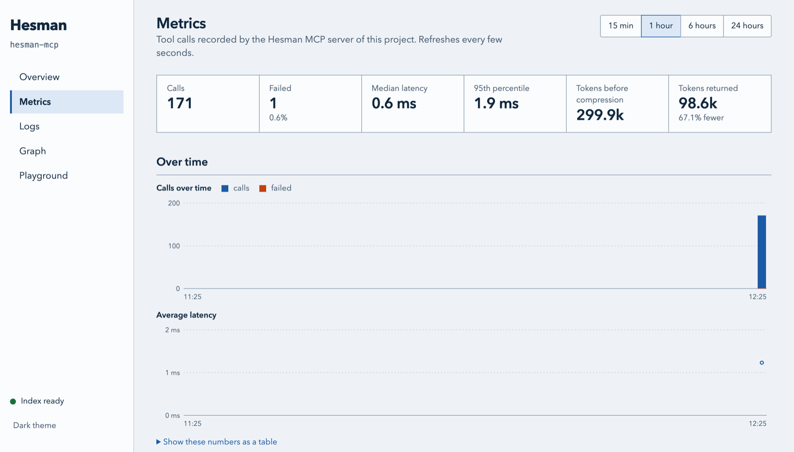
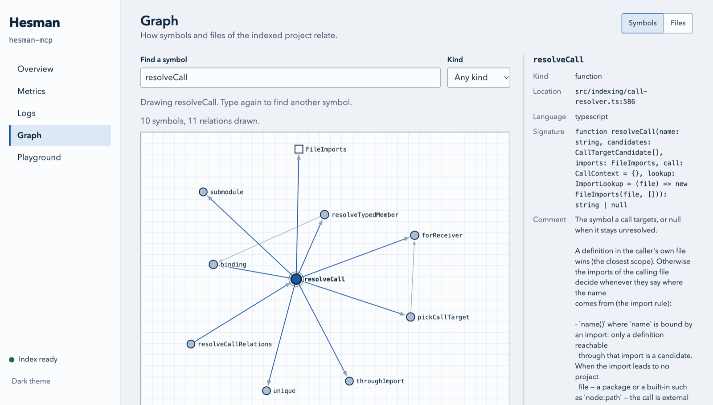

# خادم Hesman MCP

[](https://nodejs.org/)
[](../../LICENSE)

🌐 **اقرأ هذه الوثيقة بـ:** [English](../../README.md) | [Tiếng Việt](./README.vi.md) | [Русский](./README.ru.md) | [Deutsch](./README.de.md) | [Français](./README.fr.md) | [中文](./README.zh.md) | [日本語](./README.ja.md) | **العربية** | [Español](./README.es.md) | [Português](./README.pt.md)

**Hesman** هو خادم MCP (بروتوكول سياق النموذج) من الجيل التالي يمنح وكلاء البرمجة الذكية فهماً عميقاً لقاعدة الشيفرة البرمجية الخاصة بك — الرموز، رسوم الاستدعاءات، التبعيات، والبحث الدلالي — مع إجابات مصممة لتستهلك أقل قدر من الرموز المميزة: في هذا المستودع تعيد `get_context` رموزاً مميزة أقل بنسبة 80–96% من الملف كاملاً، ويكون عدد الرموز في قوائم المستدعين أو المراجع أقل بنسبة 66–72% من JSON العادي (راجع [القياس في هذا المستودع](#القياس-في-هذا-المستودع)). كل شيء يعمل على جهازك: لا واجهات برمجية خارجية، ولا خوادم LSP، ولا تُرسل شيفرتك إلى أي مكان أبداً.

---

## جدول المحتويات

- [لماذا Hesman؟](#لماذا-hesman)
- [بداية سريعة](#بداية-سريعة)
- [الميزات](#الميزات)
- [كيف يعمل تقليل الرموز المميزة](#كيف-يعمل-تقليل-الرموز-المميزة)
- [التنصيب والإعداد](#التنصيب-والإعداد)
- [لوحة التحكم](#لوحة-التحكم)
- [إلغاء التثبيت](#إلغاء-التثبيت)
- [مرجع الأدوات](#مرجع-الأدوات)
- [الإعدادات](#الإعدادات)
- [مرجع واجهة الأوامر](#مرجع-واجهة-الأوامر)
- [اللغات المدعومة](#اللغات-المدعومة)
- [الهيكلة](#الهيكلة)
- [إعداد التطوير](#إعداد-التطوير)
- [المتطلبات](#المتطلبات)
- [التوثيق](#التوثيق)
- [الرخصة](#الرخصة)

---

## لماذا Hesman؟

وكلاء البرمجة الذكية أقوياء لكنهم مكلفون. كل سطر شيفرة يقرؤونه يكلف رموزاً مميزة. إرسال ملف كامل عندما يحتاج الوكيل إلى دالة واحدة فقط يهدر السياق والمال.

يحل Hesman هذه المشكلة عن طريق:

- **تقديم ما يحتاجه الوكيل فقط** — دالة محددة، مستدعيها، ما تستدعيه، أو الرموز المتأثرة بتغيير.
- **ضغط الشيفرة وتشذيبها** — تزيل `get_context` التعليقات والأسطر الفارغة وتعيد فقط الأسطر المحيطة بموضع التركيز بدلاً من الملف كاملاً.
- **قوائم مضغوطة** — تُعيد المستدعين والمستدعى منهم والمراجع والرموز وملخصات الملفات كصفوف تحت أعمدة مسماة، مجمّعة حسب الملف، مع مسارات نسبية إلى المشروع؛ ولا يُحذف أي صف. ولا تكون الاستجابة أكبر من حمولتها الخام أبداً (راجع [خط أنابيب تقليل الرموز المميزة](#خط-أنابيب-تقليل-الرموز-المميزة)).
- **العمل على جهازك** — لا مفاتيح API، لا خدمة خارجية، ولا زمن انتظار بسببها. شيفرتك لا تغادر جهازك أبداً. التنزيلات الوحيدة هي نموذج التضمين عند أول استخدام وملفات grammar الخاصة باللغات التي تُجلب عند الطلب؛ ويمكن إيقاف كليهما (`--no-semantic`، `HESMAN_GRAMMARS_OFFLINE=1`).
- **توفير قابل للقياس** — كل استجابة أداة باستثناء `index_status` تتضمن `_meta.reduction` التي تُظهر بالضبط كم رمزاً مميزاً تم توفيره مقارنة بالمخرجات الخام.

النتيجة: وكلاء يعملون أسرع، بتكلفة أقل، وباستدلال أدق لأنهم يرون الشيفرة الصحيحة، لا كل الشيفرة.

---

## بداية سريعة

الحزمة `hesman-mcp` غير موجودة بعد في سجل npm، لذا يُنصَّب Hesman اليوم من المصدر:

```bash
# 1. احصل على Hesman وابنِه (Node.js ≥ 20)
git clone https://github.com/ocsen-hoc-code/hesman-mcp.git
cd hesman-mcp
npm install
npm run download:parsers
npm run build

# 2. سجّله لدى عملاء الذكاء الاصطناعي لديك (يكتشف Claude Code و Cursor و VS Code و Codex، …)
node dist/index.js setup
```

أعد تشغيل العميل وافتح مشروعاً. يكتب `setup` أمر التشغيل الذي يناسب طريقة تنصيب Hesman (هنا: مسارات مطلقة إلى `node` و `dist/index.js`، فلا حاجة إلى وجود أي شيء في PATH)؛ راجع [أمر التشغيل](#أمر-التشغيل).

بعد نشر الحزمة، تصبح البداية السريعة كلها سطراً واحداً:

```bash
npx -y hesman-mcp setup   # فقط بعد نشر hesman-mcp على npm
```

يجيب الخادم وكيلك فوراً ويفهرس في الخلفية (بضع ثوانٍ لمعظم المشاريع): الأدوات الـ 11 تعمل مباشرة، وتضع علامة `_meta.indexing` على النتائج ما دام الفهرس غير مكتمل، وتبلغ `index_status` عن التقدم.

---

## الميزات

### ذكاء الشيفرة البرمجية

| الإمكانية | الوصف |
|---|---|
| **البحث عن الرموز** | إيجاد الدوال، الكلاسات، التوابع حسب الاسم — مطابقة تامة، ضبابية، أو بالبادئة (< 1 مللي ثانية) |
| **اجتياز رسم الاستدعاءات** | التنقل بين المستدعين والمستدعى منهم حتى 3 مستويات عمقاً |
| **تتبع المراجع** | إيجاد كل استخدام لرمز عبر قاعدة الشيفرة البرمجية |
| **تحليل التأثير** | رؤية ما سينكسر إذا أعدت تسمية رمز أو حذفته أو غيرت توقيعه |
| **البحث الدلالي** | صف ما تبحث عنه بلغة طبيعية واعثر على الشيفرة المطابقة |
| **البحث الهيكلي** | إيجاد أنماط شيفرة مثل `console.$METHOD($$$ARGS)` مع التقاطات مسماة |
| **تحليل التبعيات** | رؤية ما يستورده ملف وما يستورد منه |
| **نوافذ السياق** | الحصول على شيفرة مركزة ومضغوطة حول أي موقع في ملف |

### خط أنابيب تقليل الرموز المميزة

يقلل Hesman الرموز المميزة بثلاث طرق. تبلغ كل استجابة عن توفيرها الفعلي في `_meta.reduction`، ولا تكون الاستجابة أكبر من حمولتها الخام أبداً.

| الطبقة | التقنية | التوفير المقاس | ينطبق على |
|---|---|---|---|
| **الوضع المضغوط** | يزيل التعليقات والأسطر الفارغة والمسافات في نهاية الأسطر | من 0 إلى 16% من مقتطف الشيفرة، بحسب عدد التعليقات والأسطر الفارغة فيه (`mode: "full"` مقابل `"compact"`) | `get_context` |
| **تشذيب السياق** | يعيد نطاق أسطر حول موضع التركيز بدلاً من الملف كاملاً | 96.0% مع القيمة الافتراضية ±5 أسطر، و79.7% مع ±40 سطراً (ملف من 514 سطراً)؛ و0% عند طلب الملف كاملاً | `get_context` |
| **القوائم المضغوطة** | صفوف تحت أعمدة مسماة، مجمعة حسب الملف، مع مسارات نسبية إلى المشروع | 66–72% للمستدعين والمستدعى منهم والمراجع؛ و35–41% لقوائم الرموز وملخصات الملفات والتبعيات وتحليل التأثير | `find_symbol`، `get_references`، `get_callers`، `get_callees`، `get_file_structure`، `list_dependencies`، `impact_analysis` |

`find_pattern` و`semantic_search` تعيدان حمولتهما الخام (`_meta.reduction: "0.0%"`). الأرقام من هذا المستودع؛ راجع [القياس في هذا المستودع](#القياس-في-هذا-المستودع) للجدول الكامل وطريقة إعادة إنتاجه. حقل `_meta.reduction` في كل استجابة يبلغ عن التوفير الدقيق لعبء عملك.

### جاهز للإنتاج

- **مجموعة العمال** — فهرسة متوازية عبر أنوية المعالج، بحجم تلقائي افتراضياً
- **مراقبة الملفات** — إعادة فهرسة تدريجية عند تغير الملفات عبر chokidar
- **إيقاف تشغيل آمن** — يصرف الأعمال النشطة، يفرغ المخازن، وينهي العمال بنظافة
- **فهرسة ببصمة المحتوى** — يعاد تحليل الملفات فقط عندما يتغير محتواها فعلياً
- **دعم المستودعات المتعددة (monorepo)** — يكتشف تلقائياً pnpm و lerna و nx و turbo و npm workspaces
- **التشخيص** — يطبع `hesman diag` الذاكرة، إحصائيات المخازن، حالة المجموعة، ومقاييس ذاكرة التخزين المؤقت
- **مختبر محلياً** — مجموعة الاختبارات الكاملة، بما فيها الاختبارات من طرف إلى طرف عبر الخادم الحقيقي، تعمل على macOS؛ أما Linux و Windows فلم يُتحقق منهما بعد

---

## كيف يعمل تقليل الرموز المميزة

### الطبقة 1: الوضع المضغوط

يزيل التعليقات، الأسطر الفارغة، والمسافات في نهاية الأسطر مع الحفاظ على التعليقات السحرية (`// @ts-ignore`، `// eslint-disable-*`).

قبل:
```typescript
// This function calculates the total price
// including tax and shipping
function calculateTotal(
  items: CartItem[],      // shopping cart items
  taxRate: number,        // local tax rate
): number {
  let total = 0;

  // Sum up item prices
  for (const item of items) {
    total += item.price * item.quantity;
  }

  // Apply tax
  total = total * (1 + taxRate);

  return total;
}
```

بعد:
```typescript
function calculateTotal(
  items: CartItem[],
  taxRate: number,
): number {
  let total = 0;
  for (const item of items) {
    total += item.price * item.quantity;
  }
  total = total * (1 + taxRate);
  return total;
}
```

### الطبقة 2: تشذيب السياق

الأداة `get_context` لا تعيد الملف كاملاً. بل تعيد نطاق الأسطر المطلوب مع `contextLines` سطراً فوقه وتحته (الافتراضي 5، والحد الأقصى 200)، ثم تطبق الوضع المضغوط على ذلك المقتطف. يقارن `_meta.reduction` النتيجة بالملف كاملاً، ويسرد `_meta.layers` ما طُبق (`compact`، `prune`).

التشذيب يجري بنطاق الأسطر فقط: لا يتتبع المستدعين ولا المستدعى منهم. لقراءة ما تستدعيه دالة أو ما يستدعيها، اسأل `get_callees` / `get_callers` عن المواقع ثم اطلب `get_context` لكل موقع.

### الطبقة 3: القوائم المضغوطة

القائمة الطويلة تكرر الأشياء نفسها في كل صف: مسار ملف طويل، وأسماء الحقول، وقيم لا تتغير أبداً. الشكل المضغوط يكتب كلاً منها مرة واحدة: أسماء الحقول في `columns`، والمسار مرة واحدة لكل ملف، نسبياً إلى المشروع. هذه إجابة حقيقية من `get_callers`:

```json
{
  "format": "compact",
  "columns": ["symbolId", "name", "kind", "line", "depth", "callLine", "callFile"],
  "files": [
    { "file": "src/indexing/file-watcher.ts", "rows": [["a182668c09c39b47", "scan", "method", 78, 1, 79, null]] }
  ],
  "_meta": { "originalTokens": 101, "compressedTokens": 54, "reduction": "46.5%", "compressed": true, "layers": ["group", "columns", "paths"] }
}
```

لا يُسقط أي صف ولا يُلخَّص أي شيء؛ ويمكن تمرير `symbolId` والمسار النسبي `file` و`line` مباشرة إلى الأدوات الأخرى. تستخدم `get_file_structure` و`list_dependencies` قائمة `rows` مسطحة واحدة. عندما لا يكون الشكل المضغوط أصغر (قائمة فارغة، أو صف واحد)، تُعاد الحمولة الخام. مرّر `format: "full"` لأي من هذه الأدوات للحصول على الكائنات الخام بمسارات مطلقة. تُجلب القوائم الطويلة صفحةً صفحةً عبر `topK`، وبالنسبة إلى `get_references` عبر `cursor` أيضاً.

### قياس التوفير

كل استجابة أداة باستثناء `index_status` تتضمن كتلة `_meta` فيها التوفير الفعلي في الرموز المميزة:

```json
{
  "_meta": {
    "originalTokens": 4782,
    "compressedTokens": 190,
    "reduction": "96.0%",
    "compressed": false,
    "layers": ["prune"]
  }
}
```

هذا المثال استدعاء حقيقي لـ `get_context` (القيمة الافتراضية ±5 أسطر، الوضع المضغوط) على ملف من 514 سطراً: المقتطف مضغوط مسبقاً من قبل الأداة، لذا تُذكر طبقة `prune` فقط، و `compressed: false` تعني أن ضاغط الاستجابات لم يجد شيئاً آخر يزيله. حقل `_meta.reduction` يقيس مقارنة بعدد الرموز المميزة في الملف الأصلي كاملاً، فيعطيك التوفير الحقيقي من البداية إلى النهاية. الاستجابات التي لن يصغر حجمها تُعاد كما هي مع `reduction: "0.0%"`؛ وهي لا تكون سالبة أبداً. دقق بالضبط مقدار ما يوفره Hesman في أعباء عملك الحقيقية بفحص `_meta.reduction` في أي استجابة أداة.

---

## التنصيب والإعداد

### المتطلبات الأساسية

- **Node.js** ≥ 20.0.0
- **npm** (أو pnpm / yarn)

### التنصيب من المصدر

هذه هي الطريقة التي تعمل اليوم.

```bash
git clone https://github.com/ocsen-hoc-code/hesman-mcp.git
cd hesman-mcp
npm install
npm run download:parsers   # تنزيل محللات Tree-sitter WASM
npm run build              # ترجمة TypeScript
npm link                   # اختياري: جعل `hesman` متاحاً في PATH
```

بدون `npm link`، استخدم `node /path/to/hesman-mcp/dist/index.js` حيثما يذكر هذا الملف `hesman`.

### التنصيب من npm (بعد نشر الحزمة)

الحزمة `hesman-mcp` غير موجودة بعد في سجل npm. عندما تُنشر:

```bash
npx -y hesman-mcp setup     # بلا تنصيب: العملاء يشغلون Hesman عبر npx
npm install -g hesman-mcp   # أو تنصيب عام يضع `hesman` في PATH
```

### التسجيل مع وكلاء الذكاء الاصطناعي

```bash
hesman setup                         # قائمة اختيار بالعملاء الموجودين على هذا الجهاز
hesman setup --yes                   # بلا أسئلة: إعداد كل عميل مكتشف
hesman setup --client cursor vscode  # إعداد عملاء محددين
hesman setup --dry-run --all         # طباعة التغيير الدقيق لكل عميل دون كتابة أي شيء
hesman remove                        # تراجع: إزالة Hesman من كل العملاء مجدداً
```

| العميل | `--client` | ما يغيره `hesman setup` (نطاق المستخدم) | `--scope project` |
|---|---|---|---|
| Claude Code | `claude-code` | يشغل `claude mcp add --scope user hesman -- <launch command>`؛ وبدون الـ CLI يعدل `~/.claude.json` | `.mcp.json` |
| Claude Desktop | `claude-desktop` | `claude_desktop_config.json` | — |
| OpenAI Codex CLI | `codex` | يشغل `codex mcp add hesman -- <launch command>`؛ وبدون الـ CLI يعدل `~/.codex/config.toml` | `.codex/config.toml` |
| Cursor | `cursor` | `~/.cursor/mcp.json` | `.cursor/mcp.json` |
| Google Antigravity | `antigravity` | `~/.gemini/config/mcp_config.json` | `.agents/mcp_config.json` |
| VS Code (Copilot) | `vscode` | الملف `mcp.json` في دليل المستخدم الخاص بـ VS Code | `.vscode/mcp.json` |
| Gemini CLI | `gemini-cli` | `~/.gemini/settings.json` | `.gemini/settings.json` |
| Windsurf | `windsurf` | `~/.config/devin/mcp_config.json` | — |

- لا يُمس إلا مدخل `hesman`. الملف الذي يتغير يُنسخ أولاً إلى `<file>.hesman.bak`، ويعيده `hesman remove` بايتاً ببايت إذا لم يتغير فيه شيء آخر في الأثناء.
- المدخل لا يحمل أي مسار مشروع: يعثر Hesman على المشروع بنفسه (انظر أدناه). هناك استثناءان: **Claude Desktop** ليست له مساحة عمل، لذا يثبت مدخله مشروعاً واحداً (الدليل الحالي، أو `--project-root <path>`)، و **Cursor** يحصل على `--project-root ${workspaceFolder}` في نطاق المشروع فقط (في الملف العام `~/.cursor/mcp.json` قد يكون ذلك المتغير هو دليلك الرئيسي، لذا لا يسمي المدخل العام أي مشروع).
- بالنسبة إلى **Antigravity** و **Windsurf**، طريقة تمرير المشروع إلى الخادم غير موثقة؛ يطبع `hesman setup` ملاحظة تطلب منك التحقق بعد أول تشغيل.
- ملفات الإعدادات التي تحتوي على تعليقات (JSONC) لا تُعدَّل: يبلغ `hesman setup` عنها ويتركها دون مساس.
- الأمر `hesman install --agent <name>` ما زال يعمل بوصفه اسماً بديلاً مهملاً لـ `hesman setup --client <name> --yes`.

بعد الإعداد، أعد تشغيل العميل وسيكون Hesman متاحاً كخادم MCP.

### قواعد استخدام الوكلاء (اختيارية)

خادم MCP المنصَّب ليس بالضرورة خادماً مستخدماً: كثيراً ما يواصل الوكلاء اللجوء إلى grep وقراءة الملفات كاملة. يكتب `hesman setup --rules` أيضاً كتلة قصيرة (14 سطراً) في ملف التعليمات الذي يقرؤه كل عميل محدد في **المشروع الحالي**، تبين أي أداة من أدوات Hesman تجيب عن أي سؤال. لم يُقَس بعد هل يغير ذلك عدد مرات استدعاء الوكيل للأدوات.

```bash
hesman setup --client claude-code codex --rules   # شغله داخل المشروع
hesman setup --all --rules --dry-run              # طباعة الكتلة والملفات دون كتابة أي شيء
hesman remove                                     # يحذف الكتلة أيضاً مجدداً
```

| العميل | ملف التعليمات (نسبة إلى المشروع) |
|---|---|
| Claude Code | `CLAUDE.md` |
| OpenAI Codex CLI، Windsurf | `AGENTS.md` |
| Gemini CLI، Google Antigravity | `GEMINI.md` |
| Cursor | `.cursor/rules/hesman.mdc` (ملف قواعد خاص به، `alwaysApply: true`) |
| VS Code (Copilot) | `.github/copilot-instructions.md` |
| Claude Desktop | لا يوجد: لا يقرأ أي ملف مشروع، لذا يُتخطى مع ملاحظة |

- **اختيارية.** لا يُكتب شيء بدون `--rules`. في طرفية وبدون `--yes`، يسأل setup مرة واحدة والإجابة الافتراضية هي «لا».
- تقع الكتلة بين `<!-- hesman:rules:start -->` و `<!-- hesman:rules:end -->`. تشغيل setup مرة أخرى يستبدلها في مكانها؛ النص خارج العلامتين لا يتغير أبداً، والملف المشترك بين عميلين يحصل على الكتلة مرة واحدة.
- يحذف `hesman remove` الكتلة بالضبط ويعيد الملف بايتاً ببايت؛ والملف الذي أنشأه Hesman ولا يحتوي على شيء آخر يُحذف. شغله في المشروع نفسه (أو مرر `--project-root <path>`، وهو ما يقبله `setup --rules` أيضاً).
- هذه الملفات تُودَع عادةً في git وتُشارَك مع الفريق. يسرد setup الملفات التي غيرها لتتمكن من مراجعتها (`git diff`) وتقرر هل تودعها.

### أمر التشغيل

يحدد `hesman setup --command auto|npx|global|absolute` ما الذي يشغله العملاء. لا يستخدم setup الشبكة أبداً.

| `--command` | المدخل المكتوب | يحتاج إلى |
|---|---|---|
| `npx` | `npx -y hesman-mcp@<major>` | الحزمة على npm (لم تُنشر بعد) و `npx` في PATH الخاص بالعميل؛ يصمد أمام ترقيات Node |
| `global` | `hesman` | تنصيب عام (أو `npm link`) في PATH الخاص بالعميل |
| `absolute` | `/path/to/node /path/to/hesman-mcp/dist/index.js` | لا شيء في PATH؛ شغل `hesman setup` مرة أخرى بعد تبديل إصدار Node أو نقل Hesman |

الخيار `auto` (الافتراضي) ينظر في طريقة تشغيل Hesman الجاري حالياً:

1. شُغل عبر `npx` (يعمل من دليل تخزين مؤقت `_npx`) ← `npx`؛
2. الأمر `hesman` الموجود في PATH هو هذا التنصيب نفسه (بعد حل الروابط الرمزية) ← `global`؛
3. أي شيء آخر (نسخة من المصدر، `node_modules` محلي، غير موجود في PATH) ← `absolute`.

تطبيقات سطح المكتب (Claude Desktop و Cursor و Antigravity و VS Code و Windsurf) المفتوحة من Dock أو من مشغل تطبيقات لا تحصل على PATH الخاص بالصدفة (shell) لديك. على macOS و Linux، عندما يختار `auto` الأمر `npx` أو `hesman` ولا يكون ذلك الأمر أو `node` في دليل نظام قياسي (`/usr/bin`، `/bin`، `/usr/sbin`، `/sbin`، `/usr/local/bin`، إضافة إلى `/opt/homebrew/bin` على macOS و `/snap/bin` على Linux) — وهي الحالة المعتادة مع nvm أو fnm أو volta أو asdf — يحصل هؤلاء العملاء على مدخل `absolute` بدلاً من ذلك، مع ملاحظة بتشغيل `hesman setup` مرة أخرى بعد تبديل إصدار Node. أما عملاء الطرفية (Claude Code و Codex CLI و Gemini CLI) فيرثون بيئة الصدفة ويحتفظون بالأمر المختار. وإذا حُدد `--command npx|global` صراحةً فإنه يُكتب كما طُلب لكل عميل، مع تحذير حيث قد لا يعثر عليه تطبيق سطح المكتب.

### الإعداد اليدوي لـ MCP

أضف هذا إلى ملف إعدادات MCP الخاص بوكيلك (يستخدم VS Code المفتاح `"servers"` بدلاً من `"mcpServers"` ويحتاج إلى `"type": "stdio"` في المدخل؛ ويستخدم Codex جدول TOML باسم `[mcp_servers.hesman]`):

```json
{
  "mcpServers": {
    "hesman": {
      "command": "hesman",
      "args": ["--project-root", "/path/to/your/project"],
      "env": {}
    }
  }
}
```

الخيار `--project-root` اختياري؛ انظر أدناه. القيمة `"command": "hesman"` تحتاج إلى وجود `hesman` في PATH الذي يراه العميل؛ وإلا فاستخدم `"command": "/path/to/node"` مع `"/path/to/hesman-mcp/dist/index.js"` كأول وسيط (راجع [أمر التشغيل](#أمر-التشغيل)).

### كيف يختار Hesman المشروع

عملية خادم واحدة تفهرس مشروعاً واحداً. ويُختار المشروع بهذا الترتيب:

1. **جذر صريح** — `--project-root <path>` أو `HESMAN_PROJECT_ROOT` أو `projectRoot` في `hesman.config.json`. له الأولوية دائماً.
2. **مجلدات مساحة العمل لدى عميل MCP** — عندما يدعم العميل قدرة `roots` في MCP، يسأله Hesman عن مجلداته بعد المصافحة ويفهرس أولها (المجلدات الأخرى تُسجل في السجل ولا تُفهرس). وعندما يبلغ العميل لاحقاً عن مجلد مختلف، ينتقل Hesman إليه.
3. **دليل العمل** — أقرب دليل، عند دليل عمل الخادم أو فوقه، يحتوي على دليل تحكم بالإصدارات (`.git`، `.hg`، `.svn`، `.jj`) أو ملف بيان مشروع (`package.json`، `go.mod`، `pyproject.toml`، `Cargo.toml`، …).
4. **لا مشروع** — يبدأ الخادم مع ذلك ويسرد أدواته، لكن كل أداة تعيد خطأ `NO_PROJECT` يشرح كيفية تحديد جذر.

الدليل الرئيسي (home) والأدلة الأعلى منه لا تُختار تلقائياً أبداً (الخطوتان 2 و 3)، فلا يزحف مدخل MCP عام شُغل من `~` على قرصك. يُخزن الفهرس في `.hesman/` داخل المشروع المختار.

## لوحة التحكم

يفتح `hesman ui` صفحة ويب محلية لمشروع واحد: ما الذي طلبه الوكلاء من Hesman، وكم كانت استجاباته سريعة، وكم رمزاً مميزاً وفّر، وما الذي سجّله الخادم، وما الموجود في الفهرس.

```bash
cd /path/to/project
hesman ui                 # منفذ حر؛ يفتح المتصفح
hesman ui --no-open       # اطبع الرابط فقط
hesman ui --port 4100     # منفذ ثابت
```

يجب أن يكون للمشروع فهرس (شغّل خادم MCP مرة واحدة، أو نفّذ `hesman index`). يطبع الأمر رابطاً بالشكل `http://127.0.0.1:<port>/?token=<random>`؛ أوقفه بالضغط على Ctrl+C.



| الشاشة | ما تعرضه |
|---|---|
| **Overview** | حالة الفهرس، والملفات والرموز والعلاقات، وكل لغة مع مستوى دعمها، وما هو غير متاح في لوحة التحكم |
| **Metrics** | استدعاءات الأدوات التي سجّلها خادم MCP: عددها، والإخفاقات، والزمن الوسيط والمئيني 95، والرموز قبل التقليل وبعده، عبر الزمن ولكل أداة، مع أحدث الاستدعاءات |
| **Logs** | سجل الخادم، الأحدث أولاً، مُصفّى حسب المستوى والنص، ويُحدَّث مباشرةً |
| **Graph** | ابحث عن رمز وشاهد مستدعيه وما يستدعيه في شكل رسم بياني، أو شاهد كيف تستورد الملفات بعضها بعضاً؛ واختر عقدة لتحميل جيرانها |
| **Playground** | اختر أداة، واملأ وسائطها في نموذج، ونفّذها، وشاهد الإجابة الدقيقة التي يحصل عليها الوكيل مع أرقام رموزها |



ملاحظات:

- **المقاييس والسجلات تعرض ما سجّله خادم MCP.** تبقى فارغة حتى يستدعي وكيل Hesman في هذا المشروع؛ ولا يسجّل `hesman index` وحده أي استدعاء.
- **يعمل إلى جانب خادم MCP.** لوحة التحكم عملية منفصلة تفتح الفهرس للقراءة فقط، لذا يمكن تشغيل الاثنين معاً.
- **محلية فقط.** تستمع على `127.0.0.1`، ويحتاج كل طلب إلى الرمز المميز من الرابط، والرمز يتغير مع كل تشغيل. لا يُرسل أي شيء إلى أي مكان.
- **حدّان.** لا يمكن تشغيل `semantic_search` من Playground (مخزن المتجهات يسمح بعملية واحدة، وخادم MCP يمسكه)، ولوحة التحكم تعرض الفهرس كما هو مخزّن، لا عملية جارية.

جميع الخيارات وواجهة HTTP موجودة في [docs/CLI.md](../CLI.md#hesman-ui)، وقواعد الوصول في [docs/SECURITY.md](../SECURITY.md).

---

## إلغاء التثبيت

يحتفظ Hesman ببياناته في أربعة أماكن. أزلها بهذا الترتيب، لأن الخطوتين الأولى والثانية تحتاجان إلى الأمر `hesman`.

**1. أزل Hesman من عملاء الذكاء الاصطناعي لديك**

```bash
hesman remove --dry-run        # اعرض ما سيُحذف دون كتابة أي شيء
hesman remove                  # أزل مدخل hesman من كل عميل يحتويه (نطاق المستخدم)
hesman remove --scope project  # شغّله داخل مشروع أُعدّ باستخدام --scope project
```

يحذف `hesman remove` مدخل `hesman` فقط، وإذا استخدمت `hesman setup --rules` فإنه يحذف أيضاً الكتلة الواقعة بين `<!-- hesman:rules:start -->` و`<!-- hesman:rules:end -->` في ملفات التعليمات الخاصة بالمشروع، ويبقى كل ما عداها في تلك الملفات كما كان. أعد تشغيل العملاء بعد ذلك. الملف `<config>.hesman.bak` الذي يقع بجوار ملف إعدادات أحد العملاء هو النسخة الاحتياطية التي أنشأها Hesman قبل آخر تعديل له؛ احذفه متى لم تعد بحاجة إليه.

**2. احذف فهرس كل مشروع**

```bash
cd /path/to/project
hesman clean --dry-run   # اعرض المجلد وحجمه
hesman clean --force     # احذف .hesman/ (الفهرس والمتجهات والسجلات وسجل استدعاءات الأدوات)
```

كرر ذلك في كل مشروع استُخدم فيه Hesman، أو احذف مجلد `.hesman/` الخاص بالمشروع يدوياً. إذا ضبطت `HESMAN_DATA_DIR` أو `--data-dir`، فالبيانات موجودة في ذلك المجلد بدلاً من ذلك.

**3. احذف ذاكرة grammar المؤقتة**

تُحفظ ملفات grammar التي تُنزَّل عند الطلب لكل مستخدم، خارج أي مشروع. احذف مجلد `hesman` في أول موقع ينطبق:

| الإعداد / المنصة | المجلد المراد حذفه |
|---|---|
| `HESMAN_CACHE_DIR` مضبوط | `$HESMAN_CACHE_DIR/hesman` |
| `XDG_CACHE_HOME` مضبوط | `$XDG_CACHE_HOME/hesman` |
| macOS | `~/Library/Caches/hesman` |
| Windows | `%LOCALAPPDATA%\hesman` |
| Linux وغيرها | `~/.cache/hesman` |

يطبع `hesman grammars list` مسار مجلد ذاكرة التخزين المؤقت بدقة. وإذا لم تُنزَّل أي ملفات grammar عند الطلب قط، فإن المجلد غير موجود.

**4. أزل البرنامج**

```bash
# مُنصَّب من المصدر
npm unlink -g hesman-mcp   # فقط إذا نفّذت `npm link`
rm -r /path/to/hesman-mcp  # المستودع المستنسخ

# مُنصَّب من npm (بعد نشر الحزمة)
npm uninstall -g hesman-mcp
```

يُخزَّن نموذج التضمين داخل `node_modules` الخاص بالحزمة، لذا يختفي مع البرنامج. لا يُكتب أي شيء آخر خارج الأماكن المذكورة أعلاه: لا توجد خدمة في الخلفية، ولا إعدادات على مستوى النظام.

---

## مرجع الأدوات

يوفر Hesman **11 أداة** عبر نقل stdio الخاص بـ MCP. كل استجابة أداة باستثناء `index_status` تتضمن كتلة `_meta` فيها توفير الرموز المميزة (وتعيد `impact_analysis` أيضاً `_summary` خاصة بها للملفات المتأثرة).

### التنقل في الشيفرة

| الأداة | الوظيفة | المدخلات الرئيسية |
|---|---|---|
| `find_symbol` | البحث عن الرموز بالاسم مع مطابقة تامة أو ضبابية أو بالبادئة | `name`، `kind`، `matchMode`، `topK` |
| `get_file_structure` | الحصول على شجرة هرمية لجميع الرموز في ملف | `filePath`، `includeNested` |
| `get_references` | إيجاد جميع استخدامات رمز عبر قاعدة الشيفرة | `symbolId`، `referenceKind`، `topK`، `cursor` |
| `get_context` | الحصول على شيفرة مضغوطة حول موقع محدد | `filePath`، `startLine`، `contextLines`، `mode` |

### رسم الاستدعاءات

| الأداة | الوظيفة | المدخلات الرئيسية |
|---|---|---|
| `get_callers` | إيجاد جميع الدوال التي تستدعي رمزاً معيناً (حتى 3 مستويات عمقاً) | `symbolId`، `maxDepth`، `topK` |
| `get_callees` | إيجاد جميع الدوال التي يستدعيها رمز معين (حتى 3 مستويات عمقاً) | `symbolId`، `maxDepth`، `topK` |

### التحليل

| الأداة | الوظيفة | المدخلات الرئيسية |
|---|---|---|
| `impact_analysis` | تصنيف ما سينكسر إذا تغير رمز (إعادة تسمية/حذف/تغيير توقيع) | `symbolId`، `changeType` |
| `list_dependencies` | عرض ما يستورده ملف، أو ما يستورد منه | `filePath`، `direction` |
| `semantic_search` | البحث في الشيفرة بوصف بلغة طبيعية | `query`، `topK`، `language`، `kind` |
| `find_pattern` | البحث بنمط هيكلي مع التقاطات مسماة (`$NAME`، `$$$ARGS`) | `pattern`، `language`، `topK` |

### الحالة

| الأداة | الوظيفة |
|---|---|
| `index_status` | الإبلاغ عن صحة الفهرسة: عدد الملفات، عدد الرموز، حالة المخزن، الملفات المعلقة، تقدم الفهرسة الأولية في الخلفية |

لمخططات المدخلات/المخرجات الكاملة مع الأمثلة، راجع **[docs/TOOLS.md](../TOOLS.md)**.

---

## الإعدادات

أنشئ `hesman.config.json` في جذر مشروعك (جميع الحقول اختيارية):

```json
{
  "projectRoot": ".",
  "workers": 0,
  "watchMode": true,
  "languages": ["*"],
  "ignore": ["node_modules/**", "dist/**", ".git/**", "legacy/**"],
  "semanticSearch": {
    "enabled": true,
    "defaultTopK": 10,
    "maxTopK": 50,
    "embeddingModel": "Xenova/all-MiniLM-L6-v2"
  },
  "logLevel": "info",
  "dataDir": ".hesman",
  "grammars": { "offline": false }
}
```

> **الروابط الرمزية تُتخطى أثناء الفهرسة.** ماسح المشروع ومراقب الملفات لا يتبعان الروابط الرمزية أبداً (إلى ملفات أو إلى أدلة). هذا يمنع الحلقات اللانهائية (مثل `loop -> .`)، ويبقي الشيفرة الواقعة خارج المشروع خارج الفهرس، ويتجنب تكرار الرموز. لفهرسة شيفرة مرتبطة برابط، وجه `projectRoot` إلى الدليل الحقيقي.

### أسبقية الإعدادات

تُحل الإعدادات بهذا الترتيب (اللاحق يلغي السابق):

1. **القيم الافتراضية** — مضمنة في Hesman
2. **`hesman.config.json`** — ملف إعدادات على مستوى المشروع
3. **متغيرات البيئة** — مثلاً `HESMAN_WORKERS=4`
4. **خيارات واجهة الأوامر** — مثلاً `--workers 4`

### متغيرات البيئة

| المتغير | المكافئ | الوصف |
|---|---|---|
| `HESMAN_PROJECT_ROOT` | `--project-root` | مسار المشروع المراد فهرسته |
| `HESMAN_WORKERS` | `--workers N` | عدد خيوط العمل (0 = اكتشاف تلقائي) |
| `HESMAN_LOG_LEVEL` | `--log-level` | أحد: trace، debug، info، warn، error |
| `HESMAN_DATA_DIR` | `--data-dir` | دليل بيانات الفهرس (الافتراضي: `.hesman`) |
| `HESMAN_WATCH_MODE` | `--watch-mode` | تمكين/تعطيل مراقبة الملفات (true/false) |
| `HESMAN_GRAMMARS_OFFLINE` | — | القيمة `1` أو `true`: لا تنزيل لأي grammar إطلاقاً (مفتاح الإعدادات `grammars.offline`) |
| `HESMAN_CACHE_DIR` | — | الدليل الذي يحوي ذاكرة التخزين المؤقت لملفات grammar الخاصة بكل مستخدم (`<dir>/hesman/grammars/`) |

### خيارات واجهة الأوامر

| الخيار | الوصف |
|---|---|
| `--project-root <path>` | المشروع المراد فهرسته (الافتراضي: يُكتشف تلقائياً، راجع [كيف يختار Hesman المشروع](#كيف-يختار-hesman-المشروع)) |
| `--workers <N>` | عدد خيوط العمل (0 = تلقائي) |
| `--log-level <level>` | مستوى التسجيل |
| `--data-dir <path>` | مسار دليل البيانات |
| `--watch-mode` | تمكين مراقبة الملفات |
| `--no-watch` | تعطيل مراقبة الملفات |
| `--no-semantic` | تعطيل البحث الدلالي |
| `--batch-size <N>` | عدد الملفات لكل دفعة فهرسة |

---

## مرجع واجهة الأوامر

```
hesman                         Run the MCP server over stdio (default)
hesman index [path]            Index a project without starting the server
hesman status [path]           Show indexing progress and statistics
hesman clean [path]            Delete the .hesman/ data directory
hesman clean --force           Skip confirmation prompt
hesman clean --dry-run         Preview what would be deleted without removing
hesman diag [path]             Print diagnostics: memory, store stats, pool, cache
hesman diag --json             Output diagnostics as JSON
hesman setup                   Add Hesman to your AI clients (--client, --all, --yes, --dry-run, --scope, --project-root, --command, --rules)
hesman remove                  Remove Hesman from the clients again (--client, --all, --scope, --dry-run)
hesman doctor                  Check the installation and each client's entry (--client, --json, --timeout)
hesman ui [path]               Open the local dashboard: logs, metrics, index graph, playground (--port, --no-open)
hesman grammars list           Bundled, cached and on-demand grammars with sizes (--json)
hesman grammars install <lang…> Download grammars into the cache (--all, or --from <directory> without network)
hesman install --agent <name>  Deprecated alias of: hesman setup --client <name> --yes
hesman --version, -v           Print version number
hesman --help, -h              Show help text
```

---

## اللغات المدعومة

| اللغة | الامتدادات | الفئة | ملف grammar | ما الذي يعمل |
|---|---|---|---|---|
| TypeScript | `.ts`، `.mts`، `.cts` | deep | مضمن | الرموز، رسم الاستدعاءات، تحليل التأثير |
| TSX | `.tsx` | deep | مضمن | الرموز، رسم الاستدعاءات، تحليل التأثير |
| JavaScript (و JSX) | `.js`، `.jsx`، `.mjs`، `.cjs` | deep | مضمن | الرموز، رسم الاستدعاءات، تحليل التأثير |
| Python | `.py`، `.pyw`، `.pyi` | deep | مضمن | الرموز، رسم الاستدعاءات، تحليل التأثير |
| Go | `.go` | deep | مضمن | الرموز، رسم الاستدعاءات، تحليل التأثير |
| Java | `.java` | deep | مضمن | الرموز، رسم الاستدعاءات، تحليل التأثير |
| C | `.c`، `.h` | deep | مضمن | الرموز، رسم الاستدعاءات، تحليل التأثير |
| C++ | `.cpp`، `.cc`، `.cxx`، `.hpp`، `.hh`، `.hxx`، `.ipp`، `.tpp` | deep | مضمن | الرموز، رسم الاستدعاءات، تحليل التأثير |
| C# | `.cs`، `.csx` | deep | مضمن | الرموز، رسم الاستدعاءات، تحليل التأثير |
| Rust | `.rs` | deep | مضمن | الرموز، رسم الاستدعاءات، تحليل التأثير |
| PHP | `.php`، `.phtml` | deep | مضمن | الرموز، رسم الاستدعاءات، تحليل التأثير |
| Ruby | `.rb`، `.rake`، `.gemspec`، `.ru`، `.podspec` | deep | مضمن | الرموز، رسم الاستدعاءات، تحليل التأثير |
| Kotlin | `.kt`، `.kts` | deep | مضمن | الرموز، رسم الاستدعاءات، تحليل التأثير |
| Swift | `.swift` | deep | مضمن | الرموز، رسم الاستدعاءات، تحليل التأثير |
| Bash | `.sh`، `.bash` | deep | مضمن | الرموز، رسم الاستدعاءات، تحليل التأثير |
| Lua | `.lua` | deep | مضمن | الرموز، رسم الاستدعاءات، تحليل التأثير |
| Scala | `.scala`، `.sc`، `.sbt` | structural | عند الطلب | الرموز فقط (بدون رسم الاستدعاءات) |
| OCaml | `.ml` | structural | عند الطلب | الرموز فقط (بدون رسم الاستدعاءات) |
| F# | `.fs`، `.fsx` | structural | عند الطلب | الرموز فقط (بدون رسم الاستدعاءات) |
| R | `.r` | structural | عند الطلب | الرموز فقط (بدون رسم الاستدعاءات) |
| CodeQL | `.ql`، `.qll` | structural | عند الطلب | الرموز فقط (بدون رسم الاستدعاءات) |
| Arduino | `.ino` | structural | عند الطلب | الرموز فقط (بدون رسم الاستدعاءات) |
| Elixir | `.ex`، `.exs` | structural | عند الطلب | الرموز فقط (بدون رسم الاستدعاءات) |
| كل ما عدا ذلك | أي ملف نصي | text | لا يوجد | مقاطع نصية لـ `semantic_search` و `find_pattern` و `get_context` (بدون رموز) |

الجدول أعلاه مولَّد من سجل اللغات (`npx tsx scripts/generate-language-matrix.ts`؛ ويفشل اختبار عندما يصبح قديماً). ملفات grammar الموسومة بـ *مضمن* تُشحن داخل الحزمة، لذا تعمل دون اتصال.

**ملفات grammar عند الطلب.** ملفات grammar الموسومة بـ *عند الطلب* ليست في الحزمة. في أول مرة يحتوي فيها مشروع على ملفات بإحدى هذه اللغات، تُفهرس تلك الملفات كنص فوراً وينزل الخادم الـ grammar في الخلفية (0.3–11.4 MB لكل grammar، من صفحة الإصدارات في مستودع الـ grammar نفسه على GitHub)؛ وعند وصوله تُعاد فهرسة الملفات مع الرموز. كل grammar مثبت بعنوان URL والحجم و sha256 في الملف `grammars.json` المشحون مع الحزمة؛ والتنزيل الذي لا يطابق يُهمل وتبقى الملفات نصاً. تُخزن ملفات grammar مؤقتاً لكل مستخدم، خارج المشروع: `HESMAN_CACHE_DIR`، وإلا `XDG_CACHE_HOME`، وإلا `~/Library/Caches` (على macOS) أو `%LOCALAPPDATA%` (على Windows) أو `~/.cache`، تحت `hesman/grammars/`.

- **إيقاف التنزيلات:** عين `HESMAN_GRAMMARS_OFFLINE=1`، أو `"grammars": { "offline": true }` في `hesman.config.json`. عندها لا يرسل Hesman أي طلب شبكة من أجل ملفات grammar؛ وتبقى ملفات اللغات التي تُجلب عند الطلب في فئة text ما لم يكن الـ grammar مخزناً مؤقتاً من قبل.
- **ملء ذاكرة التخزين المؤقت مسبقاً:** `hesman grammars install scala r` أو `hesman grammars install --all` (46.9 MB)؛ وعلى جهاز بلا اتصال بالشبكة، انسخ ملفات `.wasm` إليه وشغل `hesman grammars install --from <directory>`. يعرض `hesman grammars list` ما هو مضمن وما هو مخزن مؤقتاً وما هو متاح. راجع [docs/CLI.md](../CLI.md#hesman-grammars).
- **معرفة ما ينقص:** تسرد `index_status`، لكل لغة، فئتها (`deep` أو `structural` أو `text`)، وعدد الملفات، وهل الـ grammar الخاص بها مضمن أم مخزن مؤقتاً أم مفقود، ولماذا.

يثبت `grammars.json` أيضاً 17 ملف grammar ليس لها استعلام رموز بعد (Haskell و Zig و Julia و Perl و Objective-C و Odin و Luau و Starlark و HTML و CSS و JSON و YAML و TOML و XML و Markdown و HCL و Make). يمكن تنصيبها بـ `hesman grammars install`، لكن Hesman لا يستخدمها بعد: ملفات تلك اللغات تُفهرس كنص ولا يُنزل الـ grammar الخاص بها تلقائياً أبداً.

ما تعنيه الفئات اليوم:

- الفئة **deep** — التعريفات (الدوال، الكلاسات، التوابع، الثوابت، ...) مع علاقات `calls`، ومن ثم يتوفر لـ `get_callers` و `get_callees` و `get_references` و `impact_analysis` رسم استدعاءات. تُقرأ الاستدعاءات من شجرة البنية النحوية لكل لغة (تعبيرات الاستدعاء فيها، `new X(...)`، واستدعاءات Ruby و Bash بلا أقواس)، وتُربط بالاسم: ملف المستدعي نفسه أولاً، ثم الملفات التي يستوردها، ثم دليله، ثم المشروع؛ والاسم الذي يبقى ملتبساً يُترك بلا ربط بدلاً من ربطه بكل مرشح. يُربط الاستدعاء بتعريف لا بتصريح بلا جسم (نموذج أولي في C/C++، تابع واجهة أو تابع مجرد)، ويُربط `new X(...)` بالكلاس `X` لا بأحد مُنشئاته. لا تُحل الأنواع، لذا يبقى التابع المستدعى على واجهة لها عدة تنفيذات بلا ربط، ولا يُعد تابع Ruby المستدعى بلا وسائط ولا أقواس استدعاءً. علاقات الاستيراد موجودة لـ TypeScript/JavaScript و Python و Go و C/C++ (`#include "..."`) و Ruby (`require`، `require_relative`)؛ أما علاقات `extends` / `implements` فتوجد فقط حيث تكتب اللغة `class X extends Y` أو `class X implements Y`.
- الفئة **structural** — التعريفات فقط. لم تعد أي لغة مضمنة في هذه الفئة. اللغات التي تُجلب عند الطلب هي structural لأنه لا يُستخدم لها إلا استعلام الرموز الخاص بمصدرها الأصلي (upstream): لا توجد لها قاعدة رؤية (كل تعريف يُعد مُصدَّراً) ولا استخراج للاستدعاءات.
- الفئة **text** — بلا رموز؛ راجع "Text tier" في [docs/TOOLS.md](../TOOLS.md).

لا يحتاج الوكيل إلى معرفة هذا الجدول: عندما تُسأل `get_callers` أو `get_callees` أو `get_references` أو `impact_analysis` عن رمز في لغة بلا رسم استدعاءات، تحمل الاستجابة `note` مثل `call graph not available for r (symbols only)` بجانب القائمة الفارغة، فلا تُفهم الإجابة الفارغة خطأً على أنها «لا شيء يستخدم هذا».

أنواع الرموز تتبع استعلام tags الخاص بكل grammar، لذا بعضها أقل تفصيلاً من اللغة نفسها: التوابع في PHP و Kotlin هي `function`، والتعدادات (enum) في Rust و Swift والواجهات في Kotlin هي `class`، والأسماء البديلة للأنواع في Rust هي `class`. إضافة لغة تتطلب grammar، واستعلام tags، وملف تعريف (profile) صغيراً، ومدخلاً واحداً في سجل اللغات (`src/parsers/languages.ts`) — راجع [دليل المساهمة](../CONTRIBUTING.md) للحصول على تعليمات خطوة بخطوة.

---

## الهيكلة

```
                         ┌──────────────────────────────────────┐
                         │         AI Agent (Claude, etc.)       │
                         │              │  MCP stdio              │
                         └──────────────┼─────────────────────────┘
                                        │
                         ┌──────────────┼─────────────────────────┐
                         │       Hesman MCP Server                │
                         │              │                          │
                         │   ┌──────────┴──────────────────────┐  │
                         │   │      Token Reduction Pipeline    │  │
                         │   │  ┌────────────────────────────┐  │  │
                         │   │  │ 1. Compact Mode            │  │  │
                         │   │  │    Strip comments/blanks    │  │  │
                         │   │  │ 2. Context Pruning         │  │  │
                         │   │  │    A line range, not a file │  │  │
                         │   │  │ 3. Compact Lists           │  │  │
                         │   │  │    Columns, grouped by file │  │  │
                         │   │  └────────────────────────────┘  │  │
                         │   └───────────────────────────────────┘  │
                         │                                          │
                         │   ┌──────────┐ ┌──────────┐ ┌─────────┐ │
                         │   │  SQLite  │ │   ZVec   │ │ Worker  │ │
                         │   │  Store   │ │  Vector  │ │  Pool   │ │
                         │   │ (symbols)│ │ (search) │ │ (index) │ │
                         │   └────┬─────┘ └────┬─────┘ └────┬────┘ │
                         │        │            │            │       │
                         │   ┌────┴────────────┴────────────┴────┐  │
                         │   │     File Watcher (chokidar)       │  │
                         │   └───────────────────────────────────┘  │
                         └──────────────────────────────────────────┘
```

**خط أنابيب البيانات الأساسي:** تغييرات الملفات (chokidar) ← تحليل Tree-sitter (AST + رموز) ← فهرس SQLite + تضمينات ZVec ← استجابات MCP مضغوطة

**قرارات التصميم الرئيسية:**
- **لا اعتماد على LSP** — يوفر Tree-sitter تحليلاً مستقلاً عن اللغة دون تشغيل خوادم لغة
- **فهرسة تدريجية ببصمة المحتوى** — يعاد تحليل الملفات فقط عندما يتغير SHA-256
- **ضغط على مستوى الاستجابة** — البيانات الأصلية تبقى سليمة؛ ويُطبق الضغط عند حدود الاستجابة
- **قاعدة بيانات SQLite واحدة لكل مشروع** — حتى في المستودعات المتعددة (monorepo)، تتشارك كل الحزم مخزناً واحداً مع عزل بواسطة `file_path`

لوثيقة الهيكلة الكاملة بما فيها تبعيات الوحدات، مخططات المخازن، وتصميم مجموعة العمال، راجع **[docs/ARCHITECTURE.md](../ARCHITECTURE.md)**.

---

## إعداد التطوير

### المتطلبات الأساسية

- **Node.js** ≥ 20.0.0
- **npm** ≥ 10

### البدء

```bash
# الاستنساخ والتنصيب
git clone https://github.com/ocsen-hoc-code/hesman-mcp.git
cd hesman-mcp
npm install

# تنزيل محللات Tree-sitter WASM
npm run download:parsers

# التشغيل في وضع التطوير (إعادة تحميل ساخنة)
npm run dev

# البناء للإنتاج
npm run build
```

### جودة الشيفرة

```bash
npm run typecheck    # التحقق من أنواع TypeScript
npm run lint         # ESLint
npm run format       # تنسيق Prettier
```

### تشغيل الاختبارات

```bash
npm test                  # تشغيل جميع الاختبارات (وحدة + تكامل)
npm run test:watch        # وضع المراقبة أثناء التطوير
npm run test:e2e          # اختبارات شاملة من طرف إلى طرف (تشغل الخادم كاملاً)
npm run test:perf         # قياسات الأداء
```

### حدود الأداء

`npm run test:perf` يفشل عندما يكون أحد الاختبارات الأدائية أسوأ من حده (`tests/perf/thresholds.ts`). هذه حدود تُفحص على جهاز المشرف بنظام macOS مقابل ملفات المستودع التجريبية، وليست ضمانات لكل مشروع؛ ويُقاس `semantic_search` دون احتساب تضمين الاستعلام.

| المعيار | الحد |
|---|---|
| `find_symbol` (تام) | < 1 مللي ثانية |
| `find_symbol` (ضبابي) | < 5 مللي ثانية |
| `semantic_search` | < 10 مللي ثانية |
| `get_references` | < 5 مللي ثانية |

### القياس في هذا المستودع

يشغّل `node scripts/measure.mjs` الخادم المبني عبر stdio، ويتركه يفهرس نسخة نظيفة من هذا المستودع (502 ملفاً: 350 منها تحتوي رموزاً، و152 نصية؛ و7,700 رمز و27,372 علاقة)، ويستدعي كل أداة 100 مرة عبر MCP. أُجري القياس بتاريخ 2026-10-13 على Apple M3 Pro (11 نواة، 18 GB)، ونظام macOS، وNode 24. تعتمد أرقامك على الجهاز والمشروع؛ شغّل السكربت لتحصل عليها.

| بدء التشغيل والفهرسة والذاكرة | البحث الدلالي مفعّل | `--no-semantic` |
|---|---:|---:|
| الرد على مصافحة MCP بعد | 0.4 s | 0.2 s |
| جاهزية الفهرس بعد | 70.2 s | 2.4 s |
| الفهرس على القرص | 46.2 ميجابايت | 22.1 ميجابايت |
| الذاكرة عند المصافحة | 286 ميجابايت | 195 ميجابايت |
| الذاكرة مباشرة بعد الفهرسة | 673 ميجابايت | 426 ميجابايت |
| الذاكرة في حالة السكون (بعد 35 ثانية من آخر استدعاء) | 545 ميجابايت | 303 ميجابايت |

يجيب الخادم على الأدوات أثناء الفهرسة؛ وعند تشغيل البحث الدلالي تُنفَق تقريباً كل الثواني السبعين في حساب 5,760 تضميناً على المعالج. الذاكرة هي البصمة الفعلية للعملية، وهي الرقم الذي يعرضه مراقب النشاط (Activity Monitor). تُشغَّل خيوط المحلل فقط أثناء الفهرسة (أربعة على الأكثر افتراضياً) وتُحرَّر بعد 30 ثانية من الخمول.

| الأداة | الاستدعاء | الوسيط | الرموز الخام | الرموز المعادة | الاختزال |
|---|---|---:|---:|---:|---:|
| `get_context` | دالة واحدة، ±5 أسطر | 0.39 ms | 4,782 | 190 | 96.0% |
| `get_context` | دالة واحدة، ±40 سطراً | 0.46 ms | 4,782 | 970 | 79.7% |
| `get_references` | المراجع إلى `indexProject` | 0.29 ms | 3,026 | 854 | 71.8% |
| `get_callers` | مستدعو `indexProject` | 0.24 ms | 1,244 | 373 | 70.0% |
| `get_callees` | ما يستدعيه `indexProject` | 0.15 ms | 387 | 132 | 65.9% |
| `find_symbol` | البادئة `index`، 20 نتيجة | 0.38 ms | 2,326 | 1,369 | 41.1% |
| `impact_analysis` | حذف `indexProject` | 0.39 ms | 3,498 | 2,116 | 39.5% |
| `get_file_structure` | ملف مصدر واحد | 0.34 ms | 3,474 | 2,270 | 34.7% |
| `list_dependencies` | استيرادات ملف واحد | 0.11 ms | 572 | 374 | 34.6% |
| `find_symbol` | اسم تام، نتيجة واحدة | 0.14 ms | 214 | 197 | 7.9% |
| `find_pattern` | `console.$M($$$A)` في TypeScript | 38.4 ms | 2,112 | 2,112 | 0.0% |
| `semantic_search` | استعلام واحد بلغة طبيعية | 2.75 ms | 3,880 | 3,880 | 0.0% |

"الرموز الخام" هي الحمولة كما تُعاد ككائنات JSON عادية بمسارات مطلقة (وفي حالة `get_context` هي الملف كاملاً)، وتُقدَّر الرموز بأربعة أحرف لكل رمز. الزمن هو ما يراه العميل لاستدعاء واحد، بما في ذلك تغليف MCP. يتضمن `semantic_search` تضمين الاستعلام.

---

## المتطلبات

| المورد | الحد الأدنى |
|---|---|
| **Node.js** | ≥ 20.0.0 |
| **الذاكرة** | نحو 300 ميجابايت في حالة السكون و430 ميجابايت أثناء الفهرسة دون البحث الدلالي؛ ونحو 550 ميجابايت في حالة السكون و670 ميجابايت أثناء الفهرسة معه (مقاس على مشروع من 502 ملف، راجع [القياس في هذا المستودع](#القياس-في-هذا-المستودع)) |
| **القرص** | نحو 30 ميجابايت للحزمة (ملفات grammar المضمنة)، ونحو 80 ميجابايت لنموذج التضمين (تنزيل لمرة واحدة)، وحتى 47 ميجابايت لملفات grammar عند الطلب إذا نُصبت كلها، إضافة إلى الفهرس في `.hesman/` |
| **الشبكة** | للتنصيب، ولنموذج التضمين عند أول استخدام، ولملف grammar الخاص بلغة تُجلب عند الطلب في أول مرة يحتويها مشروع. لا شيء غير ذلك؛ ولا تُرسل أي شيفرة أو استعلام إلى أي مكان أبداً |

يُنزل نموذج التضمين (`all-MiniLM-L6-v2`) عند أول استخدام ويُخزن مؤقتاً إلى أجل غير مسمى في دليل التخزين المؤقت الخاص بـ Transformers.js.

---

## التوثيق

| الوثيقة | المحتوى |
|---|---|
| [README.md](../../README.md) | نظرة عامة على المشروع، الإعداد، والتكوين (هذا الملف) |
| [docs/ARCHITECTURE.md](../ARCHITECTURE.md) | الهيكلة الكاملة: تدفق البيانات، خريطة الوحدات، مخططات المخازن، تصميم مجموعة العمال |
| [docs/CLI.md](../CLI.md) | كل أمر فرعي: `setup` و `remove` و `doctor` و `ui` و `grammars`، مع الخيارات والمخرجات |
| [docs/TOOLS.md](../TOOLS.md) | مخططات المدخلات/المخرجات الكاملة لجميع الأدوات الـ 11 مع الأمثلة |
| [docs/CONTRIBUTING.md](../CONTRIBUTING.md) | إعداد التطوير، دليل الاختبارات، تأليف ملفات تعريف اللغات، قائمة مراجعة PR |
| [docs/SECURITY.md](../SECURITY.md) | نموذج التهديدات، وسائل الحماية على مدخلات الأدوات، كيفية الإبلاغ عن ثغرة |
| [CHANGELOG.md](../../CHANGELOG.md) | تاريخ الإصدارات والتغييرات |

---

## الرخصة

[MIT](../../LICENSE) — حقوق النشر (c) 2026 Minh Do

رخصة MIT تغطي الشيفرة المكتوبة من أجل Hesman. أما برمجيات الأطراف الثالثة فتحتفظ برخصتها الخاصة:

- **داخل الحزمة:** ملفات grammar الخاصة بـ Tree-sitter وملفات الاستعلامات، وكلها MIT ما عدا استعلام Elixir (Apache-2.0، وهي رخصة الـ grammar الخاص به)؛ كل منها مدرج مع مستودعه ومراجعته وحقوق نشره في [NOTICE](../../NOTICE).
- **ما ينصبه npm كتبعيات:** كلها برخص متساهلة (MIT و ISC و BSD و Apache-2.0)؛ القائمة الكاملة في [THIRD-PARTY-LICENSES.md](../../THIRD-PARTY-LICENSES.md). مكتبة التضمين `@xenova/transformers` ومخزن المتجهات `@zvec/zvec` برخصة Apache-2.0.
- **ما يُنزل وقت التشغيل:** نموذج التضمين `Xenova/all-MiniLM-L6-v2` (برخصة Apache-2.0) وملفات grammar عند الطلب (MIT، ما عدا Elixir و HCL: Apache-2.0)؛ راجع [NOTICE](../../NOTICE). التبعية `sharp` الخاصة بمكتبة التضمين تنصب نسخة libvips مبنية مسبقاً (LGPL-3.0-or-later) كمكتبة مشتركة منفصلة.
